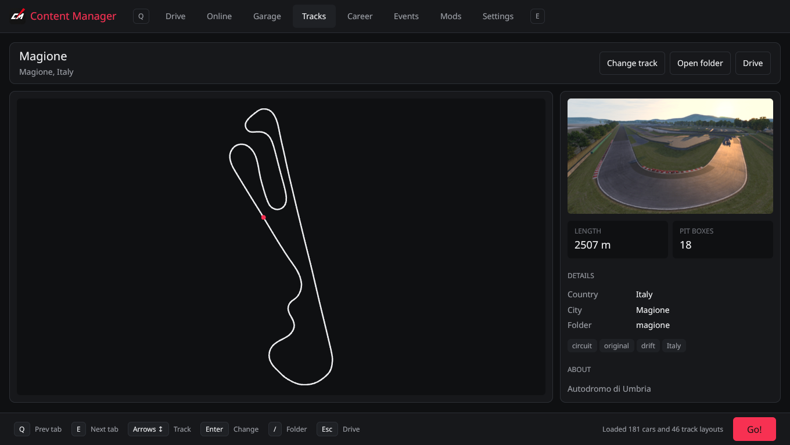
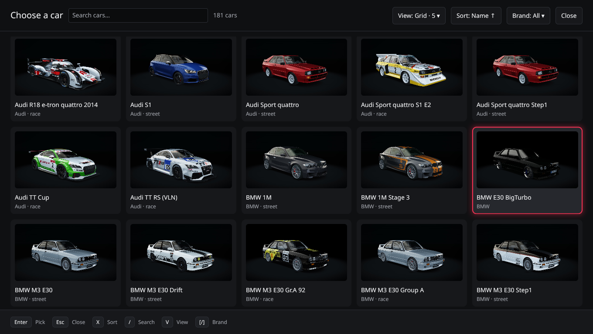
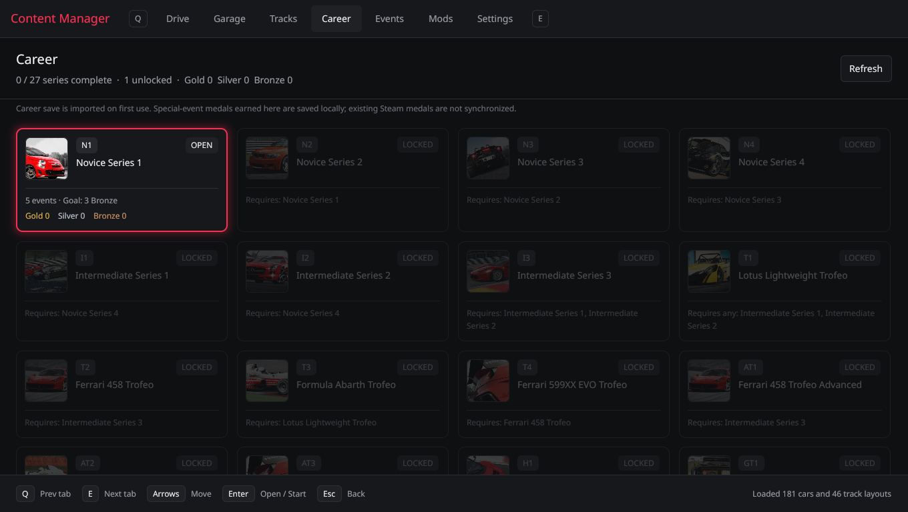
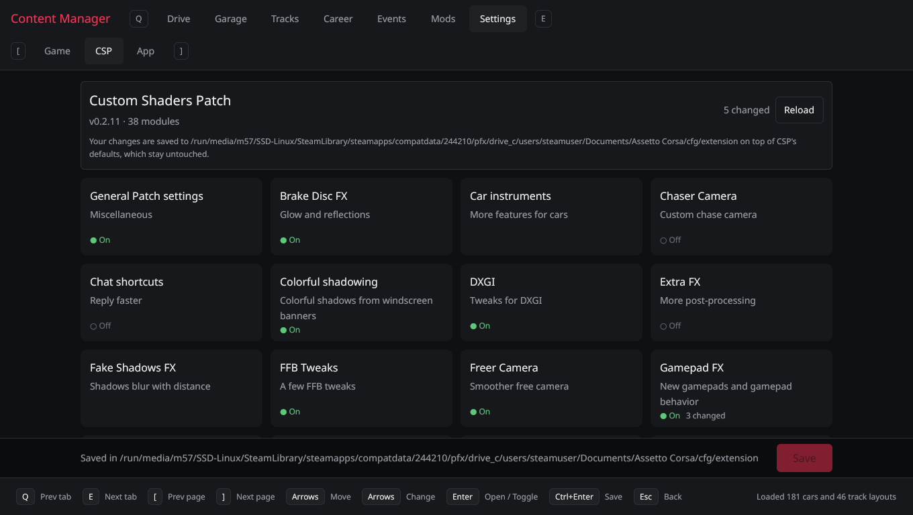
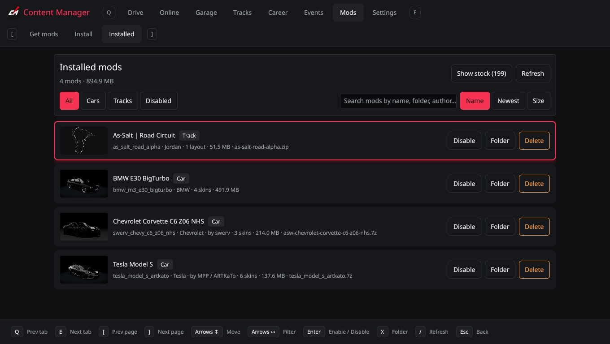

# Content Manager for Linux (`cm-rs`)

A native Linux Content Manager for Assetto Corsa, built in Rust with [GPUI](https://gpui.rs). Launches `acs.exe` through Proton with Steam runtime integration, Custom Shaders Patch (CSP) support, and controller-first navigation.

> [!NOTE]
> Single-player and local content management only for now. Online server browsing (Kunos lobbies, LFM, etc.) is not implemented yet.

**Includes:** Quick Drive, Garage & `data.acd` pack/unpack, Track layouts, Career & Special Events, embedded Mod Browser + `.zip`/`.7z`/`.rar` installer & Installed Mods manager, Game & CSP settings, gamepad navigation, and a CLI.


## Screenshots

| Garage | Track Layouts |
| :---: | :---: |
|  |  |

| Car & Track Picker (gamepad friendly) | Game Settings |
| :---: | :---: |
|  |  |

| Career Mode | Special Events |
| :---: | :---: |
|  |  |

| Custom Shaders Patch (CSP) Settings | Installed Mods Manager |
| :---: | :---: |
|  |  |

---

## Download & Install (Linux)

### Prerequisites
1. Enable Proton for Assetto Corsa in Steam and launch the game once so Steam creates the Proton prefix (`steamapps/compatdata/244210`).
2. Tested with **CachyOS Proton 11 (`cachyos-11.0-20261005-slr`)**. Other Proton builds may work, but have not been tested.

### 1. AppImage (Recommended)
Download `cm-rs-v*-x86_64.AppImage` from [GitHub Releases](https://github.com/Hy4ri/content-manager-linux/releases/latest):

```sh
chmod +x cm-rs-v*-x86_64.AppImage
./cm-rs-v*-x86_64.AppImage
```

### 2. Portable Tarball
Download `cm-rs-v*-linux-x86_64.tar.gz` from [GitHub Releases](https://github.com/Hy4ri/content-manager-linux/releases/latest), extract it, and run `./cm-rs`.

### 3. Nix / NixOS
```sh
# Run directly
nix run github:Hy4ri/content-manager-linux

# Or install into your profile
nix profile install github:Hy4ri/content-manager-linux
```

<details>
<summary><strong>Build from source (Nix / Debian / Ubuntu / Arch / Fedora)</strong></summary>

**Nix**:
```sh
nix develop path:. -c cargo run --release -p cm-app
```

**Debian / Ubuntu**:
```sh
sudo apt install build-essential pkg-config cmake ninja-build \
    libxkbcommon-x11-dev libwayland-dev libx11-xcb-dev \
    libfontconfig-dev libfreetype-dev libvulkan-dev libssl-dev libzstd-dev
```

**Arch**:
```sh
sudo pacman -S base-devel cmake ninja pkgconf libxkbcommon-x11 wayland libxcb \
    fontconfig freetype2 vulkan-icd-loader openssl zstd
```

**Fedora**:
```sh
sudo dnf install gcc gcc-c++ cmake ninja-build pkgconf libxkbcommon-x11-devel \
    wayland-devel libxcb-devel fontconfig-devel freetype-devel \
    vulkan-loader-devel openssl-devel libzstd-devel
```

Build with Rust (1.85+):
```sh
cargo build --release -p cm-app
./target/release/cm-rs
```

</details>

---

## Proton & CSP Notes

- **Launching**: Clicking **Go!** writes `race.ini` into your Proton prefix (`.../pfx/drive_c/users/steamuser/Documents/Assetto Corsa/cfg`) and runs `acs.exe` directly via Proton (Steam must be running).
- **Steam runtime (`steam-run`)**: Required on NixOS. When `steam-run` is on `PATH`, `cm-rs` wraps Proton inside it and strips the app's own library paths so they do not leak into the game.
- **Gamepad input**: Assetto Corsa reads gamepads over XInput (`INPUT_METHOD=X360`). When `cm-rs` finds a valid `libSDL2-2.0.so.0` (from SteamLinuxRuntime or system libs), it exposes it to Wine and sets `PROTON_USE_SDL=1` and `PROTON_EMULATE_STEAMINPUT=1` (configurable in **Settings > App** or `[proton_input]` in `settings.toml`). `PROTON_DISABLE_HIDRAW` is set for Sony/Switch controllers unless already set in your environment. Explicit environment variables always take precedence. (`PROTON_USE_SDL` and `PROTON_EMULATE_STEAMINPUT` are supported by CachyOS Proton and GE-Proton; stock Valve Proton ignores them.)
- **CSP `dwrite` override**: When `dwrite.dll` is present in your Assetto Corsa folder, `cm-rs` automatically appends `dwrite=n,b` to `WINEDLLOVERRIDES` while keeping any overrides you already set.
- **CSP 0.2.11 on Proton 10/11**:
  - *`dbghelp` startup crash*: Wine's builtin `dbghelp` can fail with `Failed to patch Assetto Corsa`. `cm-rs` does not bundle a third-party `dbghelp` shim, but if you place a local `dbghelp.dll` proxy (regular file, not a symlink) alongside `dbghelp_wine.dll` and `acs.publics.tsv` in `pfx/drive_c/windows/system32`, `cm-rs` detects it and appends `dbghelp=n,b` to `WINEDLLOVERRIDES`.
  - *Missing fonts*: CSP expects `Verdana` and `Segoe UI` in `pfx/drive_c/windows/Fonts`. If it exits with a missing-font error, install Microsoft Core Fonts into the prefix (e.g. `winetricks corefonts`) and copy any remaining TTFs from Assetto Corsa's `content/fonts` folder.

---

## Config & CLI

Config lives in `~/.config/cm-rs/settings.toml` (AC root, Proton path, and last Quick Drive session).

```sh
cm-rs where                                            # show detected Steam/AC/Proton paths
cm-rs list cars|tracks|events                          # list installed content
cm-rs acd unpack <car>/data.acd                        # unpack car data.acd
cm-rs acd pack <car>/data                              # pack data/ back to data.acd
cm-rs install mod-package.zip                          # install .zip, .7z, or .rar mod
```

---

## License

Licensed under the [MIT License](LICENSE).
